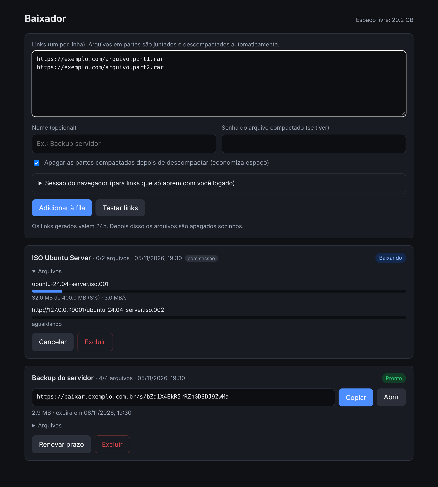
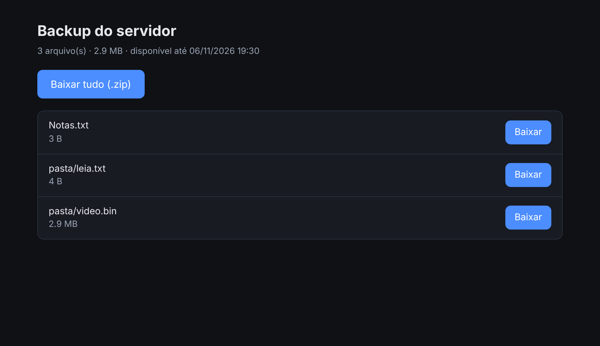

<div align="center">

# 📦 Baixador

**Cola os links. Recebe tudo pronto.**

Fila de downloads self-hosted em Docker: baixa uma lista de links um de cada vez, junta os arquivos que vieram em partes, descompacta e gera um link temporário para baixar o resultado.

[](https://github.com/MichaelRodriguesOficial/baixador/actions/workflows/docker.yml)
[](https://github.com/MichaelRodriguesOficial/baixador/pkgs/container/baixador)
[](https://michaelrodriguesoficial.github.io/baixador/)

[Página do projeto](https://michaelrodriguesoficial.github.io/baixador/) · [Instalar](#-instalar) · [Configuração](#%EF%B8%8F-configuração)

</div>

<p align="center"></p>

## ✨ O que ele faz

- **Fila de links:** cole quantos links quiser, um por linha. Eles são baixados na ordem, um de cada vez.
- **Continua de onde parou:** se a conexão cair ou o container reiniciar, o download retoma do ponto em que estava.
- **Junta e descompacta:** reconhece as partes de um mesmo arquivo, extrai tudo e, se você quiser, apaga as partes para liberar espaço.
- **Arquivos com senha:** informe a senha junto com os links.
- **Sessão do navegador:** para links que só abrem com você logado, cole os cookies exportados do navegador.
- **Testar links:** confere cada link antes de baixar e diz o motivo quando algum não vai funcionar.
- **Link temporário:** ao terminar, gera uma página com cada arquivo e um botão **Baixar tudo (.zip)**. O zip é montado na hora do download e não ocupa espaço extra no disco.
- **Limpeza automática:** quando o prazo do link acaba, os arquivos são apagados. O prazo pode ser renovado pelo painel.

## 🗂️ Formatos

| Tipo | Exemplos |
|---|---|
| RAR em partes | `arquivo.part1.rar`, `arquivo.part2.rar`... ou `arquivo.rar` + `.r00`, `.r01`... |
| Partes numeradas | `arquivo.7z.001`, `arquivo.zip.001`, `arquivo.iso.001`... |
| Compactados comuns | `.zip` `.7z` `.rar` `.tar` `.tar.gz` `.tgz` `.tar.xz` `.gz` `.bz2` `.xz` |
| Outros | Arquivos não compactados são entregues como vieram |

## 🚀 Instalar

Precisa de um servidor com Docker. A imagem é publicada no GitHub Container Registry para `amd64` e `arm64`.

```bash
mkdir baixador && cd baixador
curl -O https://raw.githubusercontent.com/MichaelRodriguesOficial/baixador/main/docker-compose.yml
# edite o arquivo e troque APP_PASSWORD
docker compose up -d
```

Acesse `http://IP-DO-SERVIDOR:8080` e entre com o usuário `admin` e a senha definida.

**Atualizar:**

```bash
docker compose pull && docker compose up -d
```

**Sem compose:**

```bash
docker run -d --name baixador --restart unless-stopped -p 8080:8080 \
  -e APP_PASSWORD=troque-esta-senha -e TZ=America/Sao_Paulo \
  -v "$(pwd)/data:/data" ghcr.io/michaelrodriguesoficial/baixador:latest
```

## ⚙️ Configuração

| Variável | Padrão | Descrição |
|---|---|---|
| `APP_PASSWORD` | *(obrigatória)* | Senha do painel |
| `APP_USER` | `admin` | Usuário do painel |
| `LINK_TTL_HOURS` | `24` | Validade do link gerado, em horas. Depois disso os arquivos são apagados |
| `PUBLIC_URL` | *(vazio)* | Endereço público usado no link, ex.: `https://baixar.seudominio.com.br`. Se ficar vazio, usa o endereço pelo qual o painel foi acessado |
| `TENTATIVAS` | `5` | Tentativas por link antes de marcar erro |
| `TZ` | `UTC` | Fuso horário |

Todos os dados ficam no volume `/data`.

## 🍪 Sessão do navegador

Alguns links funcionam no navegador porque você está logado no site. O container não tem essa sessão e recebe `403 acesso negado`. Para resolver:

1. Instale a extensão **Get cookies.txt LOCALLY** (Chrome, Edge ou Firefox).
2. Abra o site já logado, clique na extensão e use **Copy**.
3. No painel, abra **Sessão do navegador** e cole no campo **Cookies**.

Também aceita o JSON exportado pelo Cookie-Editor ou o cabeçalho `Cookie: nome=valor; ...`. Os cookies valem só para aquele download, não aparecem no painel e são apagados do disco quando o download termina.

> Sites protegidos por verificação anti-robô (Cloudflare Turnstile, captcha) costumam amarrar a sessão ao navegador e ao IP de quem passou pela verificação. Nesses casos os cookies não funcionam a partir do servidor, e o Baixador não tenta contornar essa proteção.

## 🩺 Testar links

O botão **Testar links** consulta cada link sem baixar e mostra nome, tamanho e se o download pode ser retomado. Quando um link não vai funcionar, ele mostra o motivo:

| Resultado | O que fazer |
|---|---|
| `HTTP 401/403 - acesso negado` | O site exige sua sessão: use a **Sessão do navegador** |
| `O link abriu uma página` | O link leva a uma página com botão, não ao arquivo. Inicie o download no navegador e copie o link real na lista de downloads (`Ctrl+J`) |
| `HTTP 404/410` | Arquivo não existe mais ou o link expirou |

## 🔗 A página do link

<p align="center"></p>

O painel é protegido por usuário e senha. A página do link (`/s/...`) não pede login, para poder ser compartilhada. O endereço leva um código aleatório e deixa de funcionar quando o prazo acaba.

## 💡 Bom saber

- **Só links diretos.** O link precisa iniciar o download ao ser aberto. Se ele abrir uma página com botão, contador ou captcha, o item é marcado com erro e mostra o motivo. Use **Testar links** para conferir antes.
- **Acesso de fora da rede.** Coloque o container atrás de um proxy reverso com HTTPS (Nginx, aaPanel, Traefik) e preencha `PUBLIC_URL`.
- **Espaço em disco.** O painel mostra o espaço livre. Deixe marcada a opção de apagar as partes para não ocupar o dobro do espaço.

## 🛠️ Desenvolvimento

```bash
docker compose build   # com "build: ." no docker-compose.yml
# ou, sem Docker (precisa de 7z e unar instalados):
pip install -r requirements.txt
DATA_DIR=./data APP_PASSWORD=teste python app.py
```

| Arquivo | Função |
|---|---|
| `app.py` | Servidor web, fila de downloads e descompactação |
| `templates/` | Painel, página do link e avisos |
| `docs/` | Página do projeto (GitHub Pages) |
| `.github/workflows/docker.yml` | Publica a imagem no GHCR a cada push na `main` e em tags `v*` |
